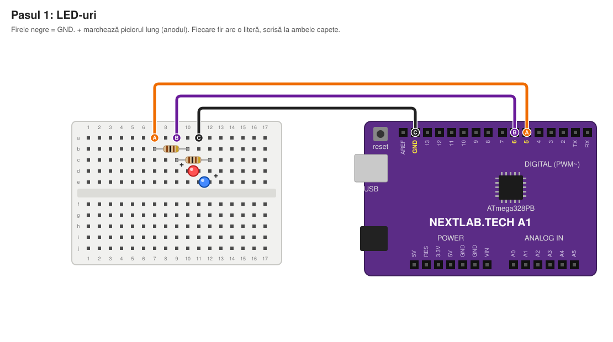

# Pasul 1: Controlul LED-urilor

## Conexiuni hardware

Pe breadboard, cele 5 găuri a-e din aceeași coloană numerotată sunt legate între ele (la fel f-j).

1. LED roșu:
   - Anodul (piciorul mai lung) → Rezistor din kit → Pin digital D5 pe Arduino.
   - Catodul (piciorul mai scurt) → coloana comună de GND a LED-urilor (vezi mai jos).

2. LED albastru:
   - Anodul (piciorul mai lung) → Rezistor din kit → Pin digital D6 pe Arduino.
   - Catodul (piciorul mai scurt) → coloana comună de GND a LED-urilor (vezi mai jos).

Pune catozii ambelor LED-uri în aceeași coloană a breadboard-ului (coloana 11 din schemă) și leag-o cu un singur fir la pinul GND din rândul de pini de sus al plăcii, lângă pinul 13. Placa are doar trei pini GND, iar ceilalți doi vor fi folosiți de senzori, la pașii 2 și 3.

### Firele

Fiecare fir din schemă are o literă, scrisă la ambele capete:

| Fir | Culoare    | Pe breadboard        | Pe placă                              | Ce leagă                     |
| --- | ---------- | -------------------- | ------------------------------------- | ---------------------------- |
| A   | portocaliu | coloana 7, rândul a  | pinul 5 (D5)                          | rezistorul LED-ului roșu     |
| B   | mov        | coloana 9, rândul a  | pinul 6 (D6)                          | rezistorul LED-ului albastru |
| C   | negru      | coloana 11, rândul a | GND din rândul de sus, lângă pinul 13 | catozii LED-urilor           |

---

## Modalitate de rulare și testare

1. Deschide fișierul `1_LEDuri.ino` în Arduino IDE.
2. Conectează placa la calculator cu cablul USB.
3. Încarcă codul pe placă.
4. Observă cum LED-urile roșu și albastru se aprind alternativ.
