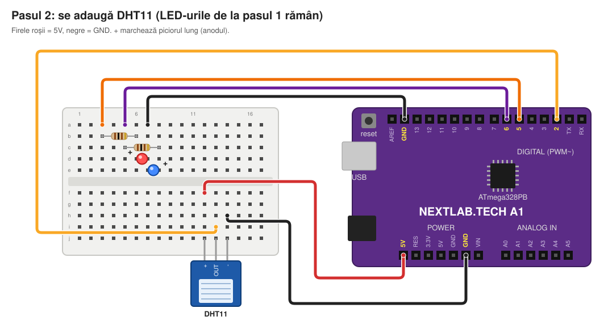

# Pasul 2: Utilizarea senzorului DHT11

## Conexiuni hardware

Schema păstrează LED-urile de la pasul 1. Modulul DHT11 este înfipt în breadboard, iar firele pleacă din aceeași coloană cu pinul lui. Pinii modulului sunt îndoiți lateral, așa că îl înfigi cu corpul spre exteriorul breadboard-ului; astfel, pinii ocupă un singur rând și sunt, de la stânga la dreapta, `-`, `OUT`, `+`.

1. Modulul DHT11 (3 pini: `+`, `OUT`, `-`):
   - Pinul `+` → primul pin 5V din zona **POWER** (de la stânga la dreapta).
   - Pinul `OUT` → Pin digital D2 pe Arduino.
   - Pinul `-` → al doilea pin GND din zona **POWER**. GND-ul din rândul de sus e folosit deja de LED-uri.

### Firele

Fiecare fir din schemă are o literă, scrisă la ambele capete. Firele A-C sunt cele de la pasul 1; la acest pas adaugi firele D-F:

| Fir | Culoare | Pe breadboard        | Pe placă                       | Ce leagă              |
| --- | ------- | -------------------- | ------------------------------ | --------------------- |
| D   | negru   | coloana 12, rândul h | al doilea GND din zona POWER   | pinul `-` al DHT11    |
| E   | galben  | coloana 13, rândul i | pinul 2 (D2)                   | pinul `OUT` al DHT11  |
| F   | roșu    | coloana 14, rândul f | primul 5V din zona POWER       | pinul `+` al DHT11    |

---

## Biblioteca necesară

Codul folosește biblioteca **DHT sensor library** (Adafruit). Instaleaz-o înainte de compilare, urmând secțiunea „4. Instalează biblioteca DHT” din [README](../README.md).

---

## Modalitate de rulare și testare

1. Deschide fișierul `2_SenzorDHT11.ino` în Arduino IDE.
2. Conectează placa la calculator cu cablul USB.
3. Încarcă codul pe placă.
4. Deschide **Serial Monitor**, setează viteza la **9600 baud** și observă valorile de temperatură și umiditate.
