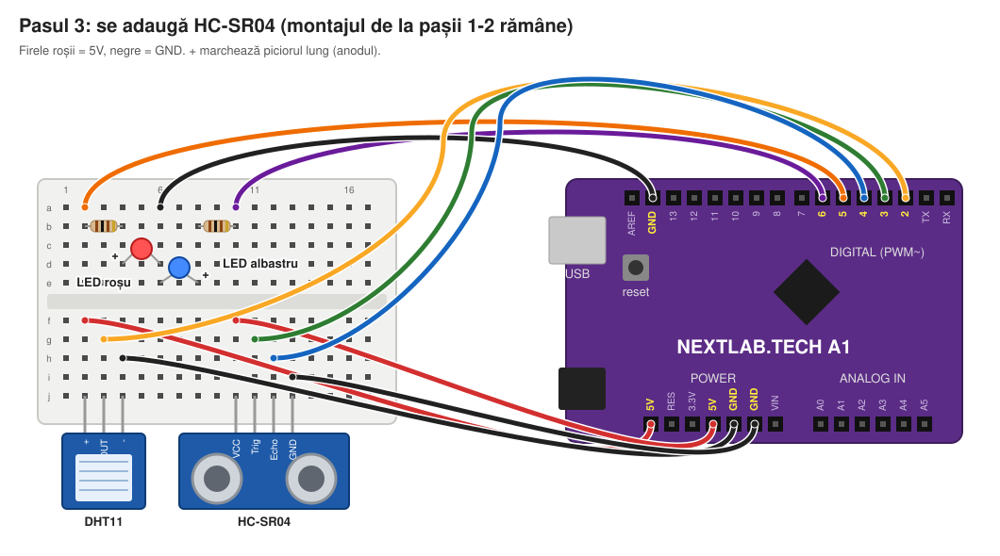

# Pasul 3: Utilizarea senzorului HC-SR04

## Conexiuni hardware

Schema păstrează montajul de la pașii 1-2. Modulul HC-SR04 este înfipt în breadboard, iar firele pleacă din aceeași coloană cu pinul lui.

1. Senzor HC-SR04:
   - Pinul **GND** → GND pe Arduino.
   - Pinul **Echo** → Pin digital D4 pe Arduino.
   - Pinul **Trig** → Pin digital D3 pe Arduino.
   - Pinul **VCC** → 5V pe Arduino.

**Montajul de la pasul 2 rămâne pe breadboard:** placa are doi pini 5V și trei pini GND. DHT11 folosește deja un pin 5V și un pin GND, așa că leagă HC-SR04 la celălalt pin 5V și la un pin GND liber.

---

## Modalitate de rulare și testare

1. Deschide fișierul `3_SenzorHCSR04.ino` în Arduino IDE.
2. Conectează placa la calculator cu cablul USB.
3. Încarcă codul pe placă.
4. Deschide **Serial Monitor** și setează viteza la **9600 baud**.
5. Testează:
   - Apropie un obiect de senzor.
   - Observă valorile distanței afișate pe monitorul serial în centimetri.

Dacă apare mesajul „Eroare: Nu s-a primit semnal de la senzorul HC-SR04.”, verifică firele de la pinii **Trig** și **Echo** sau apropie un obiect (senzorul măsoară până la aproximativ 4 m).
