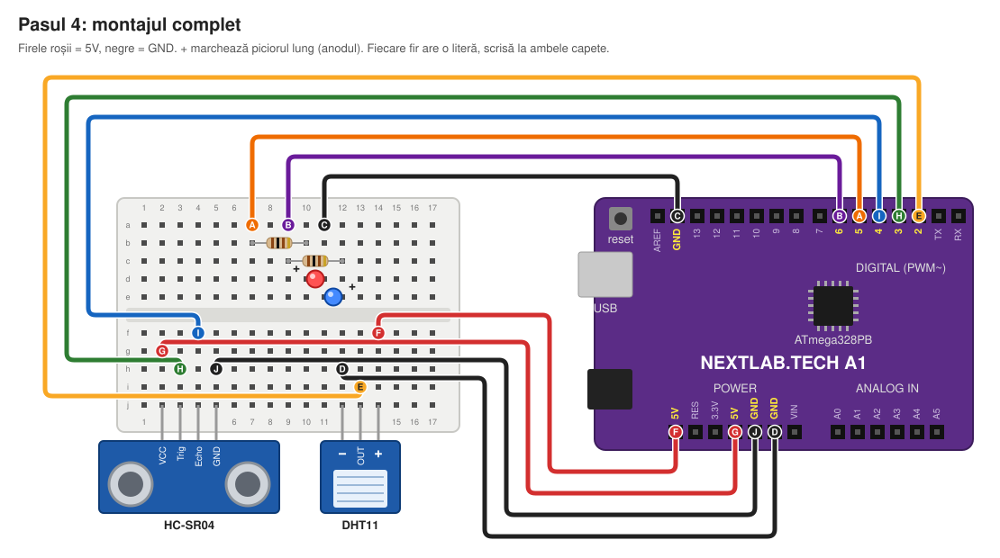

# Pasul 4: Aplicație completă – monitorizare senzori și control LED-uri

Dacă ai parcurs pașii 1-3 fără să demontezi circuitul, montajul este deja complet: verifică legăturile de mai jos și încarcă direct codul.

## Conexiuni hardware

Pe breadboard, cele 5 găuri a-e din aceeași coloană numerotată sunt legate între ele (la fel f-j).

Fiecare fir din schemă are o literă, scrisă la ambele capete:

| Fir | Culoare    | Pe breadboard        | Pe placă                              | Ce leagă                     |
| --- | ---------- | -------------------- | ------------------------------------- | ---------------------------- |
| A   | portocaliu | coloana 7, rândul a  | pinul 5 (D5)                          | rezistorul LED-ului roșu     |
| B   | mov        | coloana 9, rândul a  | pinul 6 (D6)                          | rezistorul LED-ului albastru |
| C   | negru      | coloana 11, rândul a | GND din rândul de sus, lângă pinul 13 | catozii LED-urilor           |
| D   | negru      | coloana 12, rândul h | al doilea GND din zona POWER          | pinul `-` al DHT11           |
| E   | galben     | coloana 13, rândul i | pinul 2 (D2)                          | pinul `OUT` al DHT11         |
| F   | roșu       | coloana 14, rândul f | primul 5V din zona POWER              | pinul `+` al DHT11           |
| G   | roșu       | coloana 2, rândul g  | al doilea 5V din zona POWER           | pinul **VCC** al HC-SR04     |
| H   | verde      | coloana 3, rândul h  | pinul 3 (D3)                          | pinul **Trig** al HC-SR04    |
| I   | albastru   | coloana 4, rândul f  | pinul 4 (D4)                          | pinul **Echo** al HC-SR04    |
| J   | negru      | coloana 5, rândul h  | primul GND din zona POWER             | pinul **GND** al HC-SR04     |

### 1. Alimentare

Placa are doi pini 5V și trei pini GND. Pinii 5V și doi dintre pinii GND sunt în zona **POWER** a plăcii (în textul de mai jos îi numărăm de la stânga la dreapta, ca în schemă), iar al treilea GND e în rândul de sus, lângă pinul 13.

- **5V:** ai nevoie de două legături și placa are doi pini: pinul `+` al DHT11 → primul pin 5V, pinul **VCC** al HC-SR04 → al doilea pin 5V.
- **GND:** ai nevoie de patru legături (două LED-uri, DHT11, HC-SR04), dar placa are doar trei pini. De aceea, catozii celor două LED-uri stau în aceeași coloană a breadboard-ului, legată cu un singur fir la pinul GND din rândul de sus (lângă pinul 13). Pinul **GND** al HC-SR04 → primul GND din zona POWER, pinul `-` al DHT11 → al doilea GND din zona POWER.

### 2. LED-uri

- **LED roșu:**
  - Anodul (piciorul mai lung) → Rezistor din kit → Pin digital D5 pe Arduino.
  - Catodul (piciorul mai scurt) → coloana comună de GND a LED-urilor.
- **LED albastru:**
  - Anodul (piciorul mai lung) → Rezistor din kit → Pin digital D6 pe Arduino.
  - Catodul (piciorul mai scurt) → coloana comună de GND a LED-urilor.

### 3. Senzor DHT11

Modulul se înfige cu corpul spre exteriorul breadboard-ului, cu pinii `-`, `OUT`, `+` de la stânga la dreapta (vezi pasul 2).

- Pinul `+` → 5V pe Arduino (primul pin 5V).
- Pinul `OUT` → Pin digital D2 pe Arduino.
- Pinul `-` → al doilea GND din zona POWER.

### 4. Senzor HC-SR04

- Pinul **VCC** → 5V pe Arduino (al doilea pin 5V).
- Pinul **Trig** → Pin digital D3 pe Arduino.
- Pinul **Echo** → Pin digital D4 pe Arduino.
- Pinul **GND** → primul GND din zona POWER.

---

## Modalitate de rulare și testare

Codul folosește biblioteca **DHT sensor library** (Adafruit); dacă nu ai instalat-o la pasul 2, urmează secțiunea „4. Instalează biblioteca DHT” din [README](../README.md).

1. Deschide fișierul `4_LEDSiSenzori.ino` în Arduino IDE.
2. Conectează placa la calculator cu cablul USB.
3. Încarcă codul pe placă.
4. Deschide **Serial Monitor** și setează viteza la **9600 baud**.
5. Testează funcționalitatea:
   - **LED-uri:** LED-ul roșu se aprinde la cel puțin 25 °C, iar cel albastru sub 25 °C. Temperatura se citește la 5 secunde; ca să schimbi culoarea, încălzește senzorul DHT11 ținându-l câteva secunde între degete.
   - **Senzor DHT11:** Citirile de temperatură și umiditate pe Serial Monitor.
   - **Senzor HC-SR04:** Detectarea distanței pe Serial Monitor și clipirea alternativă a LED-urilor când un obiect este la mai puțin de 10 cm.
